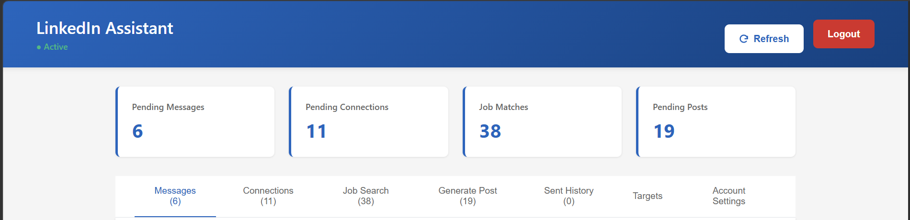
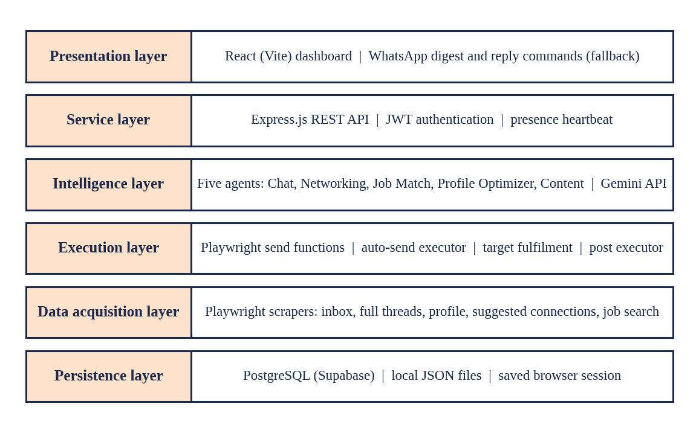

# LinkedIn AI Assistant

An AI-powered LinkedIn assistant that reads your inbox, suggests connections, matches jobs and drafts content. It drafts, you decide. Built as an internship project at Tavant Technologies.

> **Educational project.** Use it only on your own account and in line with LinkedIn's User Agreement. Nothing public-facing (posts) or high-stakes (job applications) is ever done automatically.



## What it does

| Agent | Job |
|---|---|
| Chat | Reads inbox threads and drafts replies |
| Networking | Finds suggested connections and drafts connection notes |
| Job Match | Scores job listings from 0 to 100 against your profile, with a reason |
| Profile Optimizer | Suggests improvements to your profile |
| Content | Drafts LinkedIn posts |

## Trust model: who decides what

| Action | Level |
|---|---|
| Bare connection requests | **Automatic**, toward a daily or weekly target you set |
| Message replies and connection notes | **One click**: sent only after you approve |
| Posts | **Never automatic**: always manually approved |
| Job applications and profile edits | **Manual**: you do them |

## Architecture



**Tech stack:** Node.js, Playwright, Express.js (REST API, JWT auth), React + Vite dashboard, Supabase (PostgreSQL), Gemini API, Twilio WhatsApp (fallback notifications).

## Project structure

```
src/session/    log in once and save the browser session
src/scrapers/   Playwright scrapers (inbox, threads, profile, connections, jobs)
src/agents/     the five AI agents
src/executor/   send, auto-send, target fulfilment and post executors
src/api/        Express API (port 3001)
dashboard/      React + Vite dashboard (port 5173)
```

## Getting started

1. Clone the repo and run `npm install` in the root folder and in `dashboard/`.
2. Create a `.env` file from `.env.example` and fill in your own keys (Gemini, Supabase, JWT secret, Twilio). **Never commit `.env`.**
3. Save a LinkedIn session: `node src/session/1-login-and-save-session.js`
4. Run the profile scraper first (agents need your profile data), then the other scrapers and agents.
5. Start the API server, then the dashboard (`npm run dev` in `dashboard/`).

## Author

T. Meghana Reddy, B.Tech Information Technology, Manipal University Jaipur.
